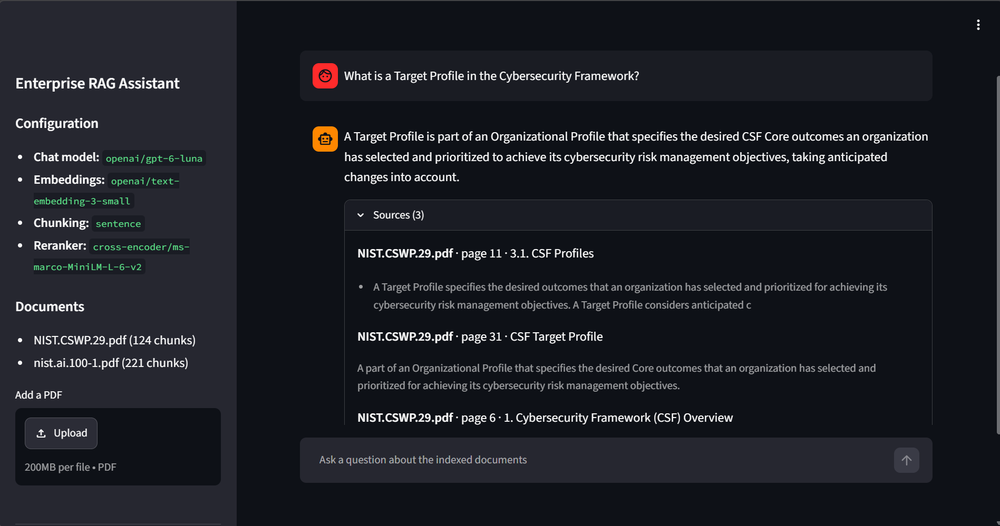

# Enterprise RAG Assistant

[](https://github.com/furkanbati/enterprise-rag-assistant/actions/workflows/ci.yml)

A document question-answering system built with **Python, FastAPI, ChromaDB, Ollama, and Docker**.

The application ingests PDF documents, retrieves relevant passages using hybrid search, reranks the results, and generates answers with source metadata and text previews.

It demonstrates an end-to-end Retrieval-Augmented Generation (RAG) workflow, from document ingestion to grounded question answering.



## Key Features

- PDF ingestion and structured document parsing with Docling
- Heading-aware, sentence-aligned chunking, with an optional semantic chunker evaluated against it
- Metadata extraction for document source, page, heading, and chunk
- Batch embedding generation with Ollama
- Local (Ollama) or cloud (OpenAI) models, selected per role with environment variables
- Persistent vector storage with ChromaDB
- Hybrid retrieval using vector search and BM25
- Reciprocal Rank Fusion (RRF) for combining retrieval results
- Cross-encoder reranking
- Source-aware answers with page metadata and preview snippets
- FastAPI REST endpoints, including a streaming chat endpoint, and interactive Swagger documentation
- Streamlit chat interface with streamed answers, source previews and timings
- Docker Compose-based application setup
- Built-in evaluation harness comparing retrieval strategies and scoring generated answers

## Architecture

```text
                     PDF Document
                          |
                          v
                  Document Ingestion
                          |
                    Docling Parser
                          |
                          v
        Heading-aware, Sentence-aligned Chunking
                          |
                          v
                 Metadata Extraction
                          |
                          v
                  Batch Embeddings
                          |
                          v
                    ChromaDB
                          |
                          |
User Question             |
      |                   |
      v                   |
Query Embedding           |
      |                   |
      +--------+----------+
               |
        +------+------+
        |             |
        v             v
   Vector Search   BM25 Search
        |             |
        +------+------+
               |
               v
       Reciprocal Rank Fusion
               |
               v
        Cross-Encoder Reranking
               |
               v
       Context and Prompt Construction
               |
               v
  Chat Model (Ollama or OpenAI)
               |
               v
     Answer + Source Metadata
```

## How It Works

### 1. Document ingestion

A PDF is submitted through the API. Docling parses the document into sections, and the chunking component packs the whole sentences of each section into chunks of roughly 300 to 1000 characters, prefixed with the section heading. Each chunk retains metadata such as its source document, page, heading, and chunk identifier. See [Chunking](#chunking) for the semantic alternative and how the two compare.

### 2. Embedding and storage

The configured embedding provider (Ollama by default, or OpenAI) generates embeddings for the chunks. ChromaDB stores the document content, embeddings, and associated metadata for later retrieval.

### 3. Hybrid retrieval

When a user submits a question:

1. The question is converted into an embedding.
2. ChromaDB retrieves semantically similar chunks.
3. BM25 retrieves keyword-relevant chunks.
4. Reciprocal Rank Fusion combines the ranked results.
5. A cross-encoder reranks the candidates by relevance.

### 4. Answer generation

The highest-ranked chunks are passed to the configured chat model (Ollama by default, or OpenAI). The API returns the generated answer along with source metadata and text previews to help users inspect the retrieved context.

## Technology Stack

| Technology | Purpose |
|---|---|
| Python | Application logic |
| FastAPI | REST API |
| Streamlit | Web chat interface |
| Docling | PDF parsing |
| Ollama | Local model inference and embeddings |
| OpenAI API | Optional cloud chat and embedding models |
| Llama 3 | Answer generation |
| nomic-embed-text | Text embeddings |
| ChromaDB | Persistent vector storage |
| rank-bm25 | Lexical retrieval |
| Sentence Transformers | Cross-encoder reranking |
| Docker Compose | Container orchestration |
| pytest | Automated testing |

## Getting Started

### Prerequisites

- Docker Desktop with Docker Compose
- Sufficient memory and disk space for the local models
- Internet access for the initial model downloads

### 1. Clone the repository

```bash
git clone https://github.com/furkanbati/enterprise-rag-assistant.git
cd enterprise-rag-assistant
```

### 2. Start the services

```bash
docker compose up --build -d
```

### 3. Download the required Ollama models

```bash
docker compose exec ollama ollama pull nomic-embed-text
docker compose exec ollama ollama pull llama3
```

The cross-encoder model is configured as `cross-encoder/ms-marco-MiniLM-L-6-v2` and is loaded when reranking is first needed. Its initial use may require downloading the model.

### 4. Open the web interface

Once the services are running, open:

**http://localhost:8501**

Upload a PDF from the sidebar, then ask questions in the chat. The sources appear as soon as retrieval is done, the answer streams in token by token, and each answer lists its sources and the retrieval and generation times.

The interactive API documentation is available at **http://localhost:8000/docs**. Both services are published on `localhost` only, so they are not reachable from other devices on the network.

## API Usage

### Upload a PDF

Endpoint:

```http
POST /upload
```

The endpoint accepts a PDF file, processes its content, generates embeddings, and indexes its chunks in ChromaDB. Other file types are rejected with status 400. The upload is written to a temporary directory and removed once it is indexed.

### Ask a question

Endpoint:

```http
POST /chat
Content-Type: application/json
```

Example request:

```json
{
  "question": "What are the four core functions of the NIST AI Risk Management Framework?"
}
```

Example response shape:

```json
{
  "answer": "The four core functions are GOVERN, MAP, MEASURE, and MANAGE.",
  "sources": [
    {
      "source": "nist.ai.100-1.pdf",
      "page": 6,
      "chunk": 27,
      "heading": "Executive Summary",
      "preview": "It describes four specific functions to help organizations address the risks of AI systems in practice..."
    }
  ]
}
```

The response above illustrates the API response format. Actual answers, source ordering, and preview text depend on the uploaded documents and retrieval results.

### Stream an answer

Endpoint:

```http
POST /chat/stream
Content-Type: application/json
```

The request is the same as for `POST /chat`. The response is newline-delimited JSON (`application/x-ndjson`), one event per line:

```text
{"type": "sources", "sources": [{"source": "nist.ai.100-1.pdf", "page": 6, ...}]}
{"type": "token", "text": "The four core"}
{"type": "token", "text": " functions are"}
...
{"type": "done", "retrieval_ms": 612, "generation_ms": 6909}
```

The sources are sent as soon as retrieval is done, before the model starts writing. If anything fails, the stream ends with `{"type": "error", "detail": "..."}` instead of `done`.

### Inspect the configuration

```http
GET /info
```

Returns the active models, the chunking configuration and the indexed documents:

```json
{
  "chat_model": "ollama/llama3",
  "embedding_model": "ollama/nomic-embed-text",
  "chunking": "sentence",
  "reranker": "cross-encoder/ms-marco-MiniLM-L-6-v2",
  "documents": [
    {"source": "nist.ai.100-1.pdf", "chunks": 221}
  ]
}
```

## Configuration

Settings live in `config.py` and can be overridden with environment variables or a `.env` file (see [`.env.example`](.env.example)).

| Setting | Purpose |
|---|---|
| `LLM_PROVIDER` | `ollama` (default) or `openai` |
| `EMBED_PROVIDER` | `ollama` (default) or `openai` |
| `CHAT_MODEL` | Answer-generation model; defaults to `llama3` for Ollama and `gpt-6-luna` for OpenAI |
| `EMBED_MODEL` | Embedding model; defaults to `nomic-embed-text` for Ollama and `text-embedding-3-small` for OpenAI |
| `OLLAMA_HOST` | Ollama service URL |
| `OPENAI_API_KEY` | Required when a provider is `openai` |
| `OPENAI_BASE_URL` | Optional: any OpenAI-compatible API |
| `OPENAI_REASONING_EFFORT` | Reasoning effort for OpenAI reasoning models (default `low`; empty to omit) |
| `RERANK_MODEL` | Cross-encoder reranking model |
| `CHROMA_PATH` | Persistent vector database path |
| `COLLECTION_NAME` | Base name of the ChromaDB collection; the embedding model and chunking configuration are appended, so each combination has its own collection |
| `RETRIEVAL_TOP_K` | Number of candidates retrieved |
| `FINAL_TOP_K` | Number of chunks retained after reranking |
| `CHUNKING_STRATEGY` | `sentence` (default) or `semantic` |
| `MAX_CHUNK_SIZE` | Maximum chunk size in characters, unless a single sentence is longer |
| `MIN_CHUNK_SIZE` | Minimum chunk size in characters |
| `SEMANTIC_PERCENTILE` | Semantic chunking: split at boundaries above this percentile of embedding distances in the document |
| `SEMANTIC_WINDOW` | Semantic chunking: sentences on each side embedded with each sentence |

The default configuration uses the Ollama service provided by Docker Compose.

## Model Providers

The chat model and the embedding model are chosen independently. To answer with OpenAI, add the key and the providers to `.env` and restart the API:

```dotenv
OPENAI_API_KEY=sk-...
LLM_PROVIDER=openai
EMBED_PROVIDER=openai
```

Switching the chat provider takes effect immediately. Each embedding model has its own collection, so after switching the embedding provider the documents have to be uploaded again. A missing key or an unknown provider stops the API at startup with a clear message.

### Local vs cloud

Measured on 2026-10-22 on the NIST AI RMF question set (20 answerable, 2 unanswerable), with the AI RMF, CSF 2.0 and FOMC transcript indexed, sentence chunking and the same cross-encoder reranker.

| | Local (Ollama) | Cloud (OpenAI) |
|---|---|---|
| Models | `llama3` + `nomic-embed-text` | `gpt-6-luna` + `text-embedding-3-small` |
| MRR, vector search only | 0.950 | 0.892 |
| MRR, full pipeline | **1.000** | **1.000** |
| Answer rate / abstention rate | 1.000 / 1.000 | 1.000 / 1.000 |
| Keyword recall | 0.950 | 0.875 |
| Mean generation time | 12.4 s (CPU) | **1.3 s** |
| Cost per question | none | < $0.0002 (6,241 chat tokens for 22 questions) |

- With the reranker, both setups retrieve the same passages, so the embedding model can be chosen for cost, speed or privacy. On its own, `nomic-embed-text` ranked slightly better here; the chunking benchmark shows the same pattern (Evidence@3 0.789 vs 0.741 for vector search, 0.878 for both after reranking).
- The lower keyword recall of the cloud setup comes from paraphrasing, not from wrong answers. Llama 3 tends to quote the document ("probability", "in a safe manner"), while GPT-6 Luna rewords it ("likelihood", "safely"). Reading the six answers that scored differently shows all of them correct. Keyword recall cannot compare models with different writing styles, which is why LLM-as-judge scoring is listed under Future Directions.
- The cost comes from the OpenAI usage page: 6,241 chat tokens for the 22 questions, reasoning tokens included, which stays under $0.0002 per question even if every token is billed at the output rate.

Reports: [local](evaluation/results/providers/ollama/report.md), [cloud](evaluation/results/providers/openai/report.md), [chunking benchmark with OpenAI embeddings](evaluation/results/chunking_benchmark/openai-embeddings/report.md). To reproduce, pass the providers to the evaluation:

```bash
docker compose exec -e LLM_PROVIDER=openai -e EMBED_PROVIDER=openai api python -m evaluation --generate --output evaluation/results/providers/openai
```

## Evaluation

The `evaluation/` package measures retrieval and answer quality against a labelled question set, so changes to chunking, retrieval, or prompts can be compared with numbers instead of impressions.

The bundled dataset, [`evaluation/datasets/nist_ai_rmf.jsonl`](evaluation/datasets/nist_ai_rmf.jsonl), contains 22 questions about the NIST AI RMF 1.0 document: 20 answerable questions labelled with their relevant pages and expected answer keywords, and 2 questions the document cannot answer.

A second dataset, [`chunking_benchmark.jsonl`](evaluation/datasets/chunking_benchmark.jsonl), adds the NIST CSF 2.0 and an FOMC press conference transcript and labels each answer with evidence sentences, so chunking changes can be measured. See the [dataset README](evaluation/datasets/README.md) and [Chunking](#chunking).

The harness runs each question through four retrieval strategies, built from the same components the API uses:

| Strategy | Description |
|---|---|
| `vector` | ChromaDB vector search only |
| `bm25` | BM25 keyword search only |
| `hybrid_rrf` | Vector + BM25 combined with Reciprocal Rank Fusion |
| `hybrid_rrf_rerank` | Hybrid retrieval followed by cross-encoder reranking (the production setup) |

### Metrics

- **Hit@k:** whether any of the top-k chunks comes from a relevant page
- **Recall@k:** share of the relevant pages covered by the top-k chunks
- **MRR:** mean reciprocal rank of the first relevant chunk
- **Evidence@k:** share of the labelled evidence sentences found in the top-k chunks (chunking benchmark only); reported with the characters the top-k chunks send to the model
- **Keyword recall:** share of expected keywords present in the generated answer (a lexical proxy, not a judge of correctness)
- **Answer rate / abstention rate:** whether the model answers answerable questions and declines unanswerable ones

### Running the evaluation

Upload `nist.ai.100-1.pdf` through `POST /upload`, then run:

```bash
# Retrieval metrics only
docker compose exec api python -m evaluation

# Retrieval metrics and generated-answer scoring
docker compose exec api python -m evaluation --generate
```

Reports are written to `evaluation/results/report.md` and `evaluation/results/report.json`. Use `--dataset` to evaluate another labelled JSONL file and `--ks` to change the cut-offs.

### Baseline results

Measured locally with `nomic-embed-text`, `cross-encoder/ms-marco-MiniLM-L-6-v2`, and `llama3` on the NIST AI RMF document (20 answerable questions). See the [full report](evaluation/results/report.md) for per-question results and generated answers.

| Strategy | Hit@1 | Hit@3 | Recall@5 | MRR@5 |
|---|---|---|---|---|
| `vector` | 0.950 | 0.950 | 0.925 | 0.950 |
| `bm25` | 0.750 | 0.900 | 0.900 | 0.825 |
| `hybrid_rrf` | 0.850 | 0.900 | 0.975 | 0.900 |
| `hybrid_rrf_rerank` | 1.000 | 1.000 | 0.975 | 1.000 |

Answer generation with `hybrid_rrf_rerank` and the top 3 chunks: keyword recall 0.950, answer rate 1.000, abstention rate on unanswerable questions 1.000.

Observations:

- RRF fusion widens coverage (the best Recall@5 among the first-stage strategies) but places weaker BM25 matches near the top; the cross-encoder restores top-rank precision.
- The full pipeline is the only strategy that ranks a relevant chunk first for every question. Vector search alone misses `q11`, which depends on the exact term "cross-cutting".
- Reranking adds roughly 0.7 seconds per query on CPU in this setup.

The dataset is small and labelled by hand, so these numbers are a regression baseline for this project, not a general benchmark.

### Fixing a retrieval miss with the evaluation

The first evaluation run exposed one consistent miss: for `q11` ("Which AI RMF function is described as cross-cutting?") the GOVERN passage never reached the top 5, so the model answered that it did not know. Tracing each stage showed two causes:

1. **BM25 tokenization.** Text was split on whitespace only, so the query token `cross-cutting?` never matched `cross-cutting` in the document, and function words such as "which", "is", and "as" dominated the scores. The tokenizer now extracts word tokens (keeping hyphenated terms) and drops common stopwords, which moved the passage from rank 18 to rank 6 in BM25.
2. **Reranker.** `BAAI/bge-reranker-base` scored an unrelated "cross-sectoral profiles" chunk above the GOVERN passage. `cross-encoder/ms-marco-MiniLM-L-6-v2` ranks the GOVERN passage first.

| Change | BM25 MRR | Hybrid RRF MRR | Full pipeline MRR | Rerank latency |
|---|---|---|---|---|
| Initial | 0.785 | 0.873 | 0.950 | ~2.2 s |
| + BM25 tokenizer | 0.825 | 0.900 | 0.950 | ~2.0 s |
| + MiniLM reranker | 0.825 | 0.900 | **1.000** | **~0.7 s** |

## Chunking

The original chunker started a new chunk when the cosine similarity between consecutive sentences fell below 0.88. Measuring it on the NIST AI RMF showed that 97% of sentence boundaries were below that threshold, so chunks were in fact cut at the first sentence boundary after 300 characters. The project now offers two explicit strategies:

- **`sentence`** (default): packs the whole sentences of each section into chunks of roughly 300 to 1000 characters.
- **`semantic`**: embeds each sentence with its neighbours and splits where the distance between consecutive windows is above a percentile of all distances in the document, so the threshold adapts to the document and the embedding model. Short segments are merged and long ones are split into balanced parts.

Both were measured on the chunking benchmark with the full retrieval pipeline. Because larger chunks raise recall simply by sending more text, the comparison holds the context size fixed:

| Evidence found within | 1200 chars | 2000 chars | 3000 chars |
|---|---|---|---|
| `sentence` | **0.854** | **0.896** | **0.921** |
| `semantic` (90th percentile) | 0.781 | 0.854 | 0.900 |

Sentence-aligned chunks retrieve more evidence at every budget. In documents with clear headings, Docling's sections already follow topic boundaries; semantic splitting mostly makes chunks larger, and their embeddings less specific. Only in the FOMC transcript, which has no headings, is the semantic chunker slightly ahead, on 14 questions. `sentence` therefore stays the default. See the [full comparison](evaluation/results/chunking_benchmark/comparison.md) for all variants, results by document, and limitations.

On all 48 answerable questions of the three-document benchmark, the full pipeline with the default settings reaches MRR 0.970 and Evidence@3 0.878 ([report](evaluation/results/chunking_benchmark/report.md)).

## Running the Tests

The project includes automated tests for the API, document parsing, chunking, ingestion, retrieval, generation, vector storage, and the evaluation harness.

Run the test suite with:

```bash
docker compose run --rm test
```

**Verified locally:** 124 tests passed. The same suite runs on GitHub Actions for every pull request and every push to `main`.

The suite includes unit tests that isolate application components from external model calls. The real-service integration and end-to-end checks were also run separately against Ollama and a temporary ChromaDB collection.

## Project Structure

```text
enterprise-rag-assistant/
├── api.py
├── chunking.py
├── config.py
├── document_parser.py
├── generator.py
├── ingestion.py
├── models.py
├── pipeline.py
├── vector_store.py
├── providers/
│   ├── base.py
│   ├── factory.py
│   ├── ollama.py
│   └── openai.py
├── retrieval/
│   ├── vector_search.py
│   ├── keyword_search.py
│   ├── fusion.py
│   ├── reranker.py
│   └── retriever.py
├── evaluation/
│   ├── datasets/
│   │   ├── README.md
│   │   ├── nist_ai_rmf.jsonl
│   │   └── chunking_benchmark.jsonl
│   ├── results/
│   │   └── chunking_benchmark/
│   ├── dataset.py
│   ├── metrics.py
│   ├── strategies.py
│   ├── evaluator.py
│   ├── report.py
│   └── __main__.py
├── ui/
│   ├── app.py
│   └── client.py
├── docs/
│   └── ui.png
├── tests/
├── .github/
│   └── workflows/
│       └── ci.yml
├── Dockerfile
├── Dockerfile.test
├── Dockerfile.ui
├── docker-compose.yml
├── .env.example
├── requirements.txt
├── requirements-dev.txt
├── requirements-ui.txt
└── README.md
```

## Design Decisions

**Hybrid retrieval:** Vector search supports semantic matching, while BM25 adds lexical matching. RRF combines both ranked lists before reranking.

**Reranking:** A cross-encoder performs a second-stage relevance ranking on the candidate chunks.

**Source metadata:** Keeping page and heading information with each chunk allows the API to return inspectable source details.

**Local or cloud inference:** Ollama keeps documents on the machine; OpenAI answers about ten times faster. Both use the same retrieval pipeline, so the choice is a configuration change.

**Containerized setup:** Docker Compose provides a repeatable way to run the API and Ollama services.

## Scope and Limitations

The current implementation focuses on PDF-based question answering. It does not currently provide:

- User authentication or authorization
- Persistent conversation history: the web interface keeps the chat on screen only, and each question is answered on its own
- Production-scale deployment guarantees

Answers depend on document quality, retrieval relevance, and model behavior. Source metadata helps inspect the retrieved material but does not guarantee that every generated claim is correct.

## Future Directions

Potential extensions include a larger multi-document evaluation set, LLM-as-judge answer scoring to compare models with different writing styles, authentication, additional document formats, and monitoring.

For chunking, the measurements point to three next steps: using the semantic chunker only for documents without headings, splitting long lists that lack sentence punctuation (one CSF appendix list currently becomes a single 5,819-character chunk), and prefixing chunks with document context so that similar frameworks such as the AI RMF and CSF are told apart more reliably.

## License

This project is licensed under the MIT License. See [`LICENSE`](LICENSE) for details.
